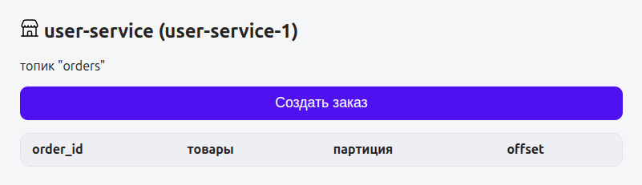
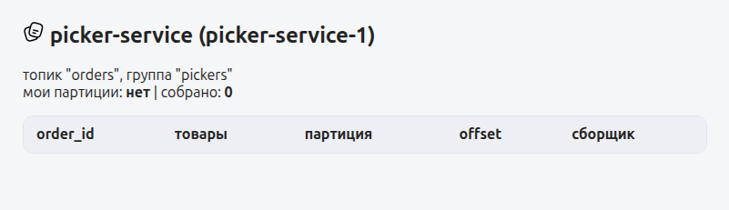

# Лаба 2 — Kafka для двух сервисов: подними и настрой с нуля

**Цель**: собрать простой конвейер из сервиса заказов и сервиса сборщика, соединив их брокером Kafka, настроенного и поднятого с нуля.

## Часть 1 — Написание двух сервисов

Первым делом создаем пару небольших сервисов ([`/user-service`](./user-service/) и [`/picker-service`](./picker-service/) ), наносим немного стилей и добавляем иконочки. Описываем их запуск в [`docker-compose.yml`](./docker-compose.yml).

## Часть 2 — Поднятие Kafka
