# Лаба 2 — Kafka для двух сервисов: подними и настрой с нуля

**Цель**: собрать простой конвейер из сервиса заказов и сервиса сборщика, соединив их брокером Kafka, настроенного и поднятого с нуля.

## Часть 1 — Написание двух сервисов

Первым делом создаем пару небольших сервисов ([`/user-service`](./user-service/) и [`/picker-service`](./picker-service/) ), наносим немного стилей и добавляем иконочки. Описываем их запуск в [`docker-compose.yml`](./docker-compose.yml).


<details>
<summary>
    Конфигурация compose для user-service и picker-service
</summary>

```yml
services:
    user-service:
        build: ./user-service
        container_name: user-service
        environment:
            KAFKA_BOOTSTRAP_SERVERS: "localhost:9092"
            KAFKA_TOPIC: "orders"
            INSTANCE_NAME: "user-service-1"
        ports:
            - "8000:8000"

    picker-service:
        build: ./picker-service
        container_name: picker-service
        environment:
            KAFKA_BOOTSTRAP_SERVERS: "localhost:9092"
            KAFKA_TOPIC: "orders"
            KAFKA_GROUP_ID: "pickers"
            INSTANCE_NAME: "picker-service-1"
            PICK_SECONDS: "2"
            AUTO_OFFSET_RESET: "earliest"
        ports:
            - "8001:8000"
```

</details>

## Часть 2 — Поднятие Kafka

### Поднятие Kafka

Настроим в [`docker-compose.yml`](./docker-compose.yml) сервис Kafka.

> [!WARNING]
> При первом запуске на образе `confluentinc/cp-kafka` брокер упал с ошибкой `CLUSTER_ID is required`, так как для запуска необходима переменная `KAFKA_CLUSTER_ID`, которую нужно генерировать вручную.
>
> В качестве решения перейдем на `apache/kafka`, который автоматически генерирует её. Для его запуска также пришлось дополнить минимальный список переменных окружения.

Разберем используемые параметры.

| Параметр                                         | Цель                                                                                                          |
| ------------------------------------------------ | ------------------------------------------------------------------------------------------------------------- |
| `KAFKA_NODE_ID`                                  | Уникальный ID этого брокера в кластере (для одиночного принят `1`)                                            |
| `KAFKA_PROCESS_ROLES`                            | Роли в KRaft: ранит данные (`broker`), управляет метаданными кластера (`controller`)                          |
| `KAFKA_LISTENERS`                                | Сетевые интерфейсы для связи: в сети контейнеров `29092`, для контроллера `29093` и для внешнего хоста `9092` |
| `KAFKA_LISTENER_SECURITY_PROTOCOL_MAP`           | Указывает слушателям протокол: простой незашифрованный `PLAINTEXT`                                            |
| `KAFKA_ADVERTISED_LISTENERS`                     | "Публичные" сетевые адреса: `KAFKA:29092` в сети Docker, `localhost:9092` на хост-машине                      |
| `KAFKA_CONTROLLER_LISTENER_NAMES`                | Указывает имя листенера для Kraft (`CONTROLLER`)                                                              |
| `KAFKA_CONTROLLER_QUORUM_VOTERS`                 | Список узлов-контроллеров, формирующих метаданные: `ID@хост:порт` (`1@kafka:29093`)                           |
| `KAFKA_OFFSETS_TOPIC_REPLICATION_FACTOR`         | Фактор репликации для смещений (`__consumer_offsets`)                                                         |
| `KAFKA_TRANSACTION_STATE_LOG_REPLICATION_FACTOR` | Фактор репликации для транзакций (`__transaction_state`)                                                      |
| `KAFKA_TRANSACTION_STATE_LOG_MIN_ISR`            | Минимум живых копий для записи транзакций                                                                     |
| `KAFKA_GROUP_INITIAL_REBALANCE_DELAY_MS`         | Задержка перед распределением партиций среди потребителей                                                     |

> [!NOTE]
> Отдельно рассмотрим виды слушателей: `CONTROLLER` определен для обмена метаданными KRaft, `PLAINTEXT` - подключение клиентов (используется в сети docker), `PLAINTEXT_HOST` - подключение внешних клиетов. Все трое в рамках лабораторной общаются без шифрования.

Нажми на кнопку, получишь результат.

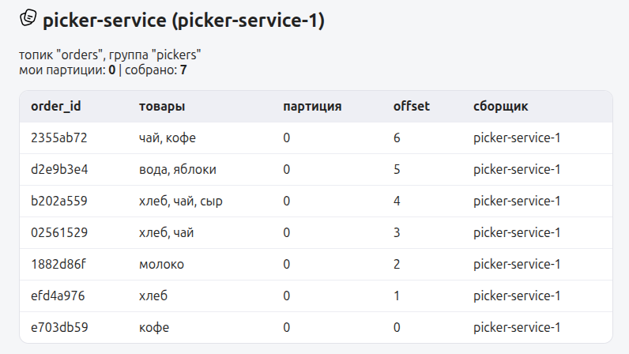

<details>
<summary>
    Конфигурация compose для двух сервисов и брокера
</summary>

```yml
name: lab2

services:
    user-service:
        build: ./user-service
        container_name: user-service
        environment:
            KAFKA_BOOTSTRAP_SERVERS: "kafka:29092" #
            KAFKA_TOPIC: "orders"
            INSTANCE_NAME: "user-service-1"
        ports:
            - "8000:8000"

    picker-service:
        build: ./picker-service
        container_name: picker-service
        environment:
            KAFKA_BOOTSTRAP_SERVERS: "kafka:29092" #
            KAFKA_TOPIC: "orders"
            KAFKA_GROUP_ID: "pickers"
            INSTANCE_NAME: "picker-service-1"
            PICK_SECONDS: "2"
            AUTO_OFFSET_RESET: "earliest"
        ports:
            - "8001:8000"

    kafka:
        image: apache/kafka:latest
        container_name: kafka
        ports:
            - "9092:9092"
        environment:
            KAFKA_NODE_ID: 1
            KAFKA_PROCESS_ROLES: "broker,controller"
            KAFKA_LISTENERS: "PLAINTEXT://0.0.0.0:29092,CONTROLLER://0.0.0.0:29093,PLAINTEXT_HOST://0.0.0.0:9092"
            KAFKA_LISTENER_SECURITY_PROTOCOL_MAP: "CONTROLLER:PLAINTEXT,PLAINTEXT:PLAINTEXT,PLAINTEXT_HOST:PLAINTEXT"
            KAFKA_ADVERTISED_LISTENERS: "PLAINTEXT://kafka:29092,PLAINTEXT_HOST://localhost:9092"
            KAFKA_CONTROLLER_LISTENER_NAMES: "CONTROLLER"
            KAFKA_CONTROLLER_QUORUM_VOTERS: "1@kafka:29093"
            KAFKA_OFFSETS_TOPIC_REPLICATION_FACTOR: 1
            KAFKA_TRANSACTION_STATE_LOG_MIN_ISR: 1
            KAFKA_TRANSACTION_STATE_LOG_REPLICATION_FACTOR: 1
            KAFKA_GROUP_INITIAL_REBALANCE_DELAY_MS: 0
        volumes:
            - kafka_data:/var/lib/kafka/data

volumes:
    kafka_data:
```

</details>

### Декларативное объявление топиков Kafka

> [!WARNING]
> На этом моменте спотыкаемся: мы не можем просто взять и декларативно описать состояния топиков в compose!

У существующий популярных решений (apache/kafka, confluentinc/cp-kafka, bitnami/kafka) это просто не реализовано, а в стороннем софте (типа wurstmeister/kafka) эта конфигурации происходит через ZooKeeper. Это не недостаток, а обоснованное решение, архитектурно необходимое для соблюдения принципа единой ответственности. Контроллер Kafka в режиме KRaft может быть не один.

Но как же нам все-таки прийти к декларативному описанию? Попридумываем, потестируем и поищем решения этой архитектурной загадки.

#### Идея 1. UI и CLI

Оба способа рабочие, но это не по ТЗ, не описывается декларативно, а также делать руками - кринж.

Вердикт: **КАТЕГОРИЧЕСКИ ОТКАЗАНО**, причина: _нет декларативности, не по заданию_.


#### Идея 2. `KAFKA_*` переменные

Задаем настройки по умолчанию для всех топиков. Например `KAFKA_NUM_PARTITIONS: 1`. Этот способ подходил бы, так как в лабе всего один топик, однако мы не можем так изменять уже существующие топики без сброса volume.

Вердикт: **ОТКАЗАНО**, причина: _бесконечное стирание volume при смене конфигурации_.


> [!WARNING]
> Во время тестирования разных подходов была обнаружена следующая проблема: приложения хранили у себя информацию о топиках, оффсетах и партиция, но при изменении этих параметров в kafka не меняли их у себя и не могли работать. Были внесены соответствующие изменения - переодическое обновление метаданных.

#### Идея 3. `kafka-init` контейнер

Запускаем команды CLI сразу после запуска kafka в отдельном похожем контейнере.

- Во-первых нет никакого сравнения желательного с действительным: при изменении любых настроек (а в процессе экспериментов ради интереса это случается часто) придется grep-ать и сравнивать результат в bash.
- Во-вторых настройки не возращаются к дефолтным: если ты забыл вернуть настройку, сбрасывай контейнер или сиди ищи.
- В итоге, этим способом мы просто упаковываем команды CLI в контейнер, это уже совсем не декларативный подход, хоть и внутри compose (не зашло).

Вердикт: **ОТКАЗАНО**, причина: _нет декларативности_.

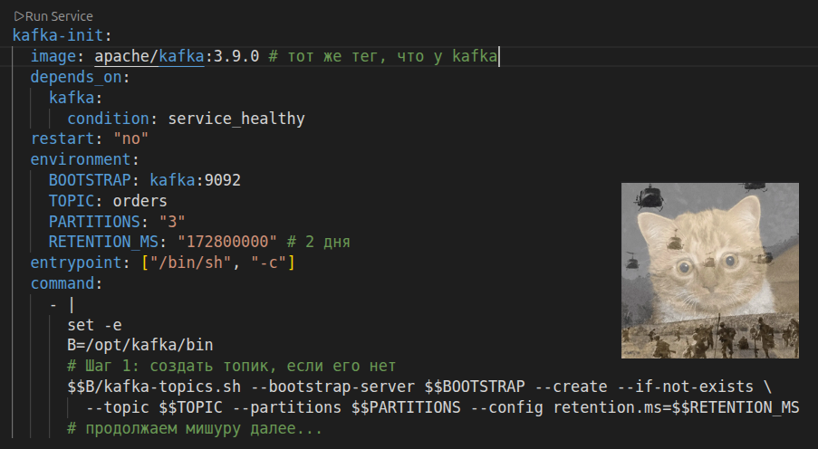

#### Идея 4. `kafka-admin` сервис

Пишем приложение, которое будет конфигурировать по AdminClient API.

**Решением загадки** стало создание [`kafka-admin`](./kafka-admin/). Сервис был добавлен в [`docker-compose.yml`](./docker-compose.yml) вместе с порядком запуска. Для конфигурации используется [`kafka-topics`](./kafka-topics.yml) для приведения топиков в желаемое описанное состояние.

```yml
topics:
    orders:
        partitions: 1
        config:
```

В [`kafka-admin/README.MD`](./kafka-admin/README.MD) можно посмотреть доступные параметры конфигурации топиков и режимы работы.

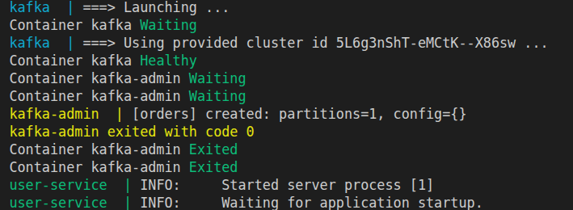

<details>
<summary>
    Конфигурация compose для двух сервисов, kafka и kafka-admin
</summary>

```yml
name: lab2

services:
    user-service:
        build: ./user-service
        container_name: user-service
        environment:
            KAFKA_BOOTSTRAP_SERVERS: "kafka:29092"
            KAFKA_TOPIC: "orders"
            INSTANCE_NAME: "user-service-1"
        ports:
            - "8000:8000"
        depends_on:
            kafka-admin:
                condition: service_completed_successfully

    picker-service:
        build: ./picker-service
        container_name: picker-service
        environment:
            KAFKA_BOOTSTRAP_SERVERS: "kafka:29092"
            KAFKA_TOPIC: "orders"
            KAFKA_GROUP_ID: "pickers"
            INSTANCE_NAME: "picker-service-1"
            PICK_SECONDS: "2"
            AUTO_OFFSET_RESET: "earliest"
        ports:
            - "8001:8000"
        depends_on:
            kafka-admin:
                condition: service_completed_successfully

    kafka-admin:
        build: ./kafka-admin
        container_name: kafka-admin
        environment:
            KAFKA_BOOTSTRAP_SERVERS: kafka:29092
        volumes:
            - ./kafka-topics.yml:/config/topics.yaml:ro
        depends_on:
            kafka:
                condition: service_healthy
        restart: "no"

    kafka:
        image: apache/kafka:4.3.1
        container_name: kafka
        ports:
            - "9092:9092"
        environment:
            KAFKA_NODE_ID: 1
            KAFKA_PROCESS_ROLES: "broker,controller"
            KAFKA_LISTENERS: "PLAINTEXT://0.0.0.0:29092,CONTROLLER://0.0.0.0:29093,PLAINTEXT_HOST://0.0.0.0:9092"
            KAFKA_LISTENER_SECURITY_PROTOCOL_MAP: "CONTROLLER:PLAINTEXT,PLAINTEXT:PLAINTEXT,PLAINTEXT_HOST:PLAINTEXT"
            KAFKA_ADVERTISED_LISTENERS: "PLAINTEXT://kafka:29092,PLAINTEXT_HOST://localhost:9092"
            KAFKA_CONTROLLER_LISTENER_NAMES: "CONTROLLER"
            KAFKA_CONTROLLER_QUORUM_VOTERS: "1@kafka:29093"
            KAFKA_OFFSETS_TOPIC_REPLICATION_FACTOR: 1
            KAFKA_TRANSACTION_STATE_LOG_MIN_ISR: 1
            KAFKA_TRANSACTION_STATE_LOG_REPLICATION_FACTOR: 1
            KAFKA_GROUP_INITIAL_REBALANCE_DELAY_MS: 0
            KAFKA_LOG_DIRS: "/var/lib/kafka/data"
        volumes:
            - kafka_data:/var/lib/kafka/data
        healthcheck:
            test:
                [
                    "CMD-SHELL",
                    "/opt/kafka/bin/kafka-broker-api-versions.sh --bootstrap-server localhost:9092 > /dev/null 2>&1",
                ]
            interval: 5s
            timeout: 10s
            retries: 12

volumes:
    kafka_data:
```

</details>

## Часть 3 — Бизнес-ситуации (решение через конфигурацию)

> [!NOTE]
> Команды управления:
>
> - Запускаемся просто `docker compose up -d`
> - Сбрасываем стенд `docker compose down -v`
> - Меняем конфиг на ходу `docker compose up kafka-admin`

### 1. Готовимся к распродаже, потом сворачиваемся

Для управления топиками определим их количество в [`kafka-topics`](./kafka-topics.yml), N партиций дают использовать топик до N потребителям _параллельно_.

#### Запускаемся с одной партицией

```yml
topics:
    orders:
        partitions: 1
        config:
```

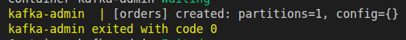

Отправляем 3 заказа (в партицию 0)

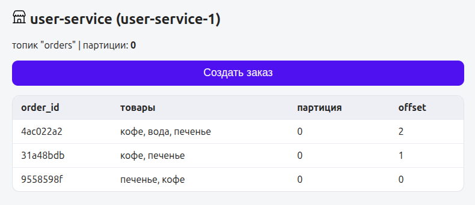

Принимаем 3 заказа из партиции 0

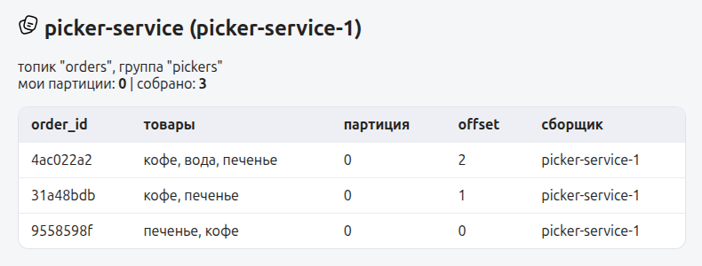

#### Запускаемся с двумя партициями

```yml
topics:
    orders:
        partitions: 2
        config:
```

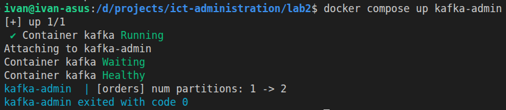

Отправляем 4 заказа (в партиции 0, 1)

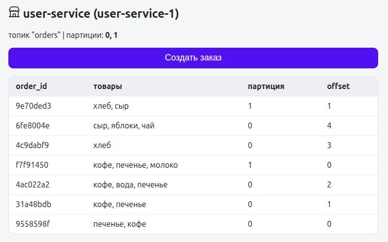

Принимаем 4 заказа из партиций 0 и 1

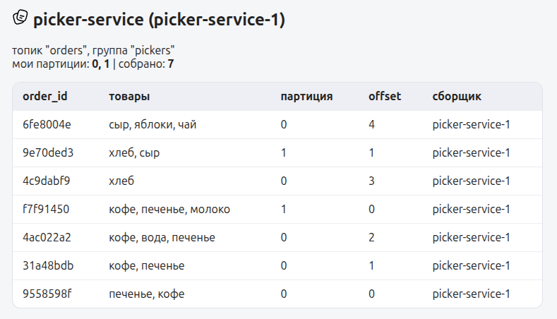

#### Пробуем уменьшить до одной партиции

```yml
topics:
    orders:
        partitions: 1
        config:
```

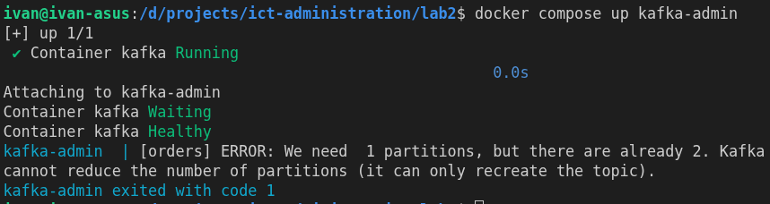

**Падаем с ошибкой!** Как и ожидалось kafka не может уменьшить количество партиций в существующем топике. Почему?

- В партиции лежат сообщения, а Kafka данные между партициями переносить не умеет.
- Перенос сломал бы гарантию порядка: порядок сообщений Kafka гарантируется только внутри одной партиции.
- Сломались бы сохранённые offset'ы групп: непонятно, куда им указывать после слияния.

### 2. Добавляем сборщиков

#### Второй сборщик _(сборщиков не больше, чем партиций)_

Оставляем рабочую структуру с двумя партициями. В [`docker-compose.yml`](./docker-compose.yml) добавляем второй сервис.

```yml
picker-service-2:
    build: ./picker-service
    container_name: picker-service-2
    environment:
        KAFKA_BOOTSTRAP_SERVERS: "kafka:29092"
        KAFKA_TOPIC: "orders"
        KAFKA_GROUP_ID: "pickers"
        INSTANCE_NAME: "picker-service-2"
        PICK_SECONDS: "2"
        AUTO_OFFSET_RESET: "earliest"
    ports:
        - "8002:8000"
    depends_on:
        kafka-admin:
            condition: service_completed_successfully
```

Запускаем `docker compose up -d picker-service-2`.

Отправляем 4 заказа (в партиции 0, 1)

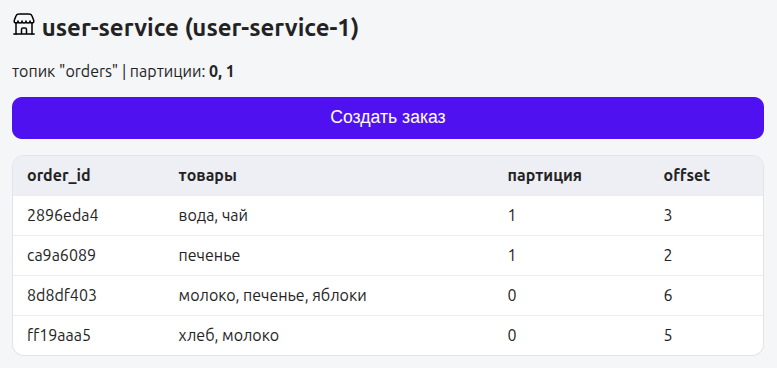

В `picker-service-1` принимаем 2 заказа из партиции 0

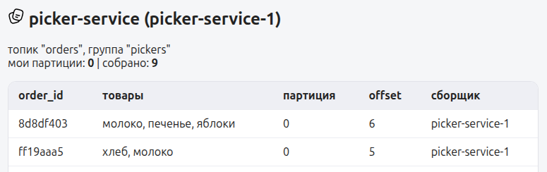

В `picker-service-2` принимаем 2 заказа из партиции 1

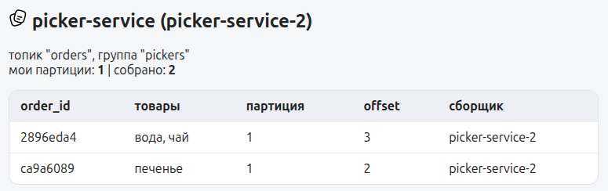

#### Третий сборщик _(сборщиков больше, чем партиций)_

Оставляем рабочую структуру с двумя партициями. В [`docker-compose.yml`](./docker-compose.yml) добавляем третий сервис.

```yml
picker-service-3:
    build: ./picker-service
    container_name: picker-service-3
    environment:
        KAFKA_BOOTSTRAP_SERVERS: "kafka:29092"
        KAFKA_TOPIC: "orders"
        KAFKA_GROUP_ID: "pickers"
        INSTANCE_NAME: "picker-service-3"
        PICK_SECONDS: "2"
        AUTO_OFFSET_RESET: "earliest"
    ports:
        - "8003:8000"
    depends_on:
        kafka-admin:
            condition: service_completed_successfully
```

Запускаем `docker compose up -d picker-service-3`.

Отправляем 6 заказов (в партиции 0, 1)

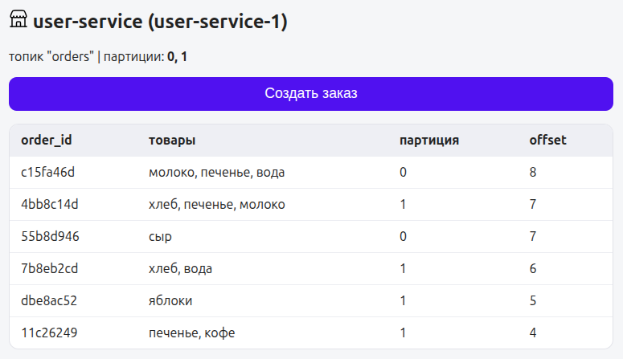

В `picker-service-1` принимаем 2 заказа из партиции 0

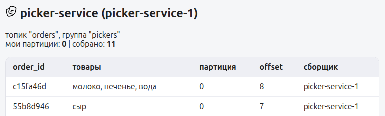

В `picker-service-2` принимаем 4 заказа из партиции 1

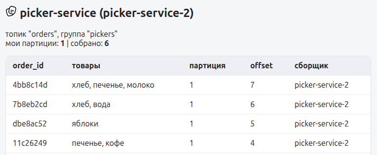

В `picker-service-3` партиций не назначено

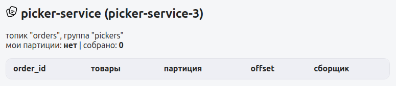

> [!NOTE]
> Заказы распределились неравномерно, потому что они распределяются в топики не по очереди, а по хешу ключа.

Третий сервис простаивает без дела. Почему?

В Kafka одну партицию в рамках группы потребителей читает ровно один сборщик. Это гарантирует порядок сообщений внутри партиции: если бы двое читали одну
партицию, они бы мешали друг другу и порядок пропал.

### 3. Сборщик упал во время деплоя

В текущей конфигурации у нас 3 сборщика и 2 партиции.

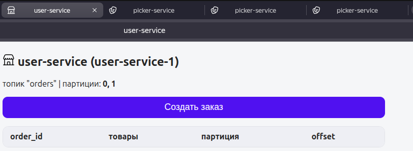

#### Роняем первого сборщика

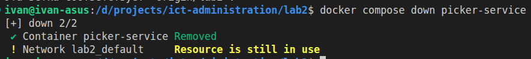

Отправляем заказы (в партиции 0, 1)

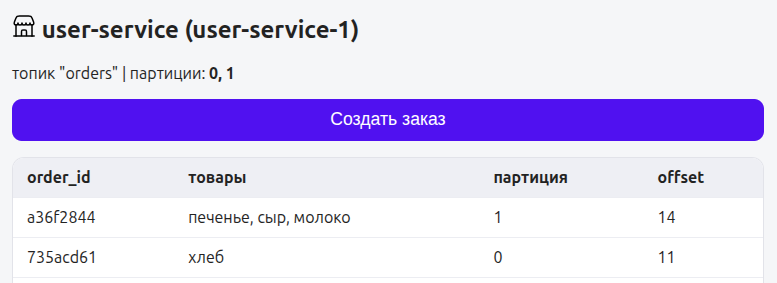

В `picker-service-2` принимаем заказы из партиции 0

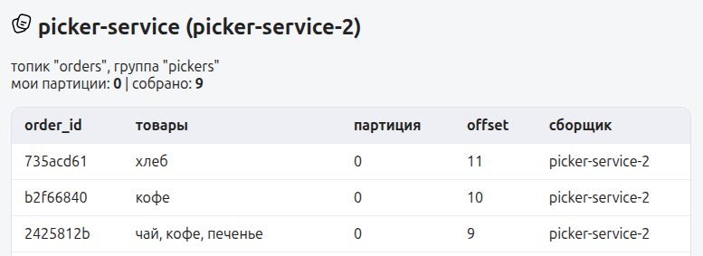

В `picker-service-3` принимаем заказы из партиции 1

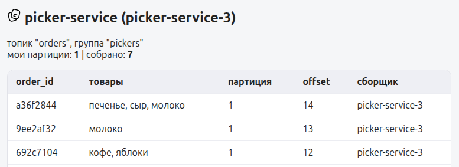

Как итог: первый сборщик лежит, второй сборщик получил 0 партицию, третий сборщик получил 1 партицию. Заказы не потерялись и обработались в нормальном режиме. Почему?

- Когда первый сборщик упал, координатор группы провёл ребаланс и заново раздал партиции целиком. Все участники отдали партиции и получили новые (eager-ребаланс в aiokafka).
- Третий сборщик хоть и был "горячим резервом", но он получил не свободную партицию, а новую согласно алгоритму ребалансировки.
- Заказы не потерялись, потому что позиция чтения хранится в Kafka, новый владелец продолжил с того же offset'а.

#### Роняем второго сборщика

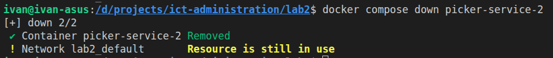

Отправляем заказы (в партиции 0, 1)

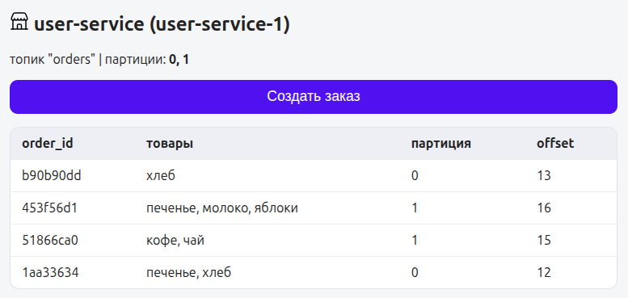

В `picker-service-3` принимаем заказы из обоих партиций

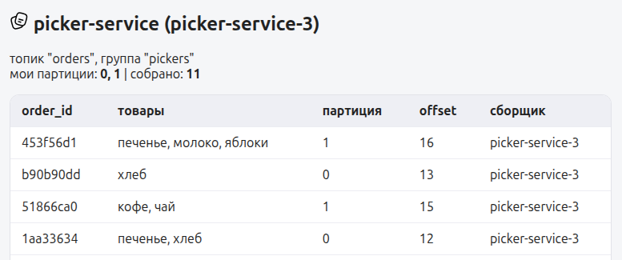

Как итог: 2/3 сборщиков лежат, а заказы не потерялись и продолжили обрабатываться, хоть и только на одном сборщике.

#### Роняем последнего сборщика

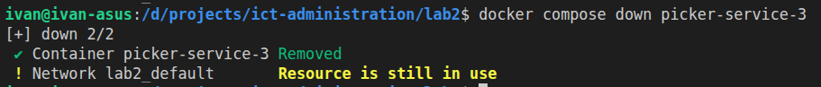

Отправляем заказы (в партиции 0, 1)

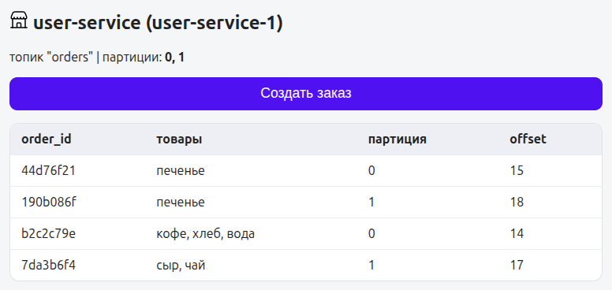

Заказы были отправлены, но больше не обрабатываются! Указанная партиция заказа явно говорит нам, что данные не потеряны, а сохранены в Kafka.

#### Поднимаем первого сборщика

В `picker-service-1` сразу со старта начинают обрабатываться заказы из обоих партиций.

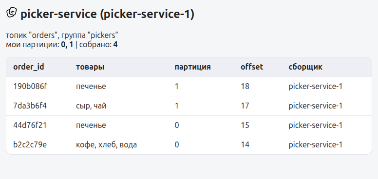

Итог: даже если все сборщики полягут, заказы останутся ждать своего часа в партициях топика Kafka и не будут потеряны.

> [!NOTE]
> Эксперементы этой части закончены: поднимем всех сборщиков и повысим количество партиций до трёх.

## Часть 4 — Поднятие Kafka UI

Посмотрим на образ `provectuslabs/kafka-ui`, на дату обновления "updated over 2 years ago", версию "v0.7.2", неоткрывающуюся документацию, 278 issues на [GitHub](https://github.com/provectus/kafka-ui). Не берем этот образ, ОТКАЗАНО.

Возьмем образ `kafbat/kafka-ui` из [GitHub](https://github.com/kafbat/kafka-ui). Опишем его в [`docker-compose.yml`](./docker-compose.yml).

```yml
kafka-ui:
    image: kafbat/kafka-ui:v1.5.0
    container_name: kafka-ui
    environment:
        KAFKA_CLUSTERS_0_NAME: local
        KAFKA_CLUSTERS_0_BOOTSTRAPSERVERS: kafka:29092
        LOGGING_LEVEL_ROOT: WARN
    ports:
        - "8080:8080"
    depends_on:
        kafka-admin:
            condition: service_completed_successfully
```

Запускаем - все работает. Находим партиции и потребителей топика "orders".

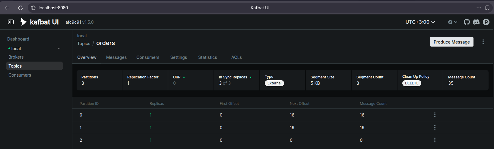
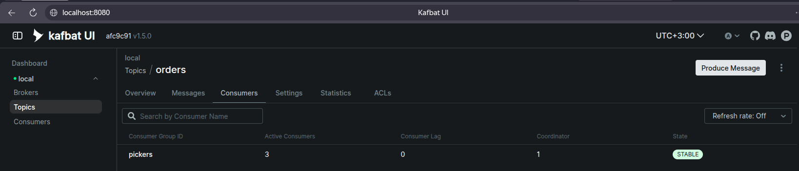

<details>
<summary>
    Конфигурация compose для сервисов, kafka, kafka-admin и kafka-ui
</summary>

```yml
name: lab2

services:
    user-service:
        build: ./user-service
        container_name: user-service
        environment:
            KAFKA_BOOTSTRAP_SERVERS: "kafka:29092"
            KAFKA_TOPIC: "orders"
            INSTANCE_NAME: "user-service-1"
        ports:
            - "8000:8000"
        depends_on:
            kafka-admin:
                condition: service_completed_successfully

    picker-service:
        build: ./picker-service
        container_name: picker-service
        environment:
            KAFKA_BOOTSTRAP_SERVERS: "kafka:29092"
            KAFKA_TOPIC: "orders"
            KAFKA_GROUP_ID: "pickers"
            INSTANCE_NAME: "picker-service-1"
            PICK_SECONDS: "2"
            AUTO_OFFSET_RESET: "earliest"
        ports:
            - "8001:8000"
        depends_on:
            kafka-admin:
                condition: service_completed_successfully

    picker-service-2:
        build: ./picker-service
        container_name: picker-service-2
        environment:
            KAFKA_BOOTSTRAP_SERVERS: "kafka:29092"
            KAFKA_TOPIC: "orders"
            KAFKA_GROUP_ID: "pickers"
            INSTANCE_NAME: "picker-service-2"
            PICK_SECONDS: "2"
            AUTO_OFFSET_RESET: "earliest"
        ports:
            - "8002:8000"
        depends_on:
            kafka-admin:
                condition: service_completed_successfully

    picker-service-3:
        build: ./picker-service
        container_name: picker-service-3
        environment:
            KAFKA_BOOTSTRAP_SERVERS: "kafka:29092"
            KAFKA_TOPIC: "orders"
            KAFKA_GROUP_ID: "pickers"
            INSTANCE_NAME: "picker-service-3"
            PICK_SECONDS: "2"
            AUTO_OFFSET_RESET: "earliest"
        ports:
            - "8003:8000"
        depends_on:
            kafka-admin:
                condition: service_completed_successfully

    kafka-ui:
        image: kafbat/kafka-ui:v1.5.0
        container_name: kafka-ui
        environment:
            KAFKA_CLUSTERS_0_NAME: local
            KAFKA_CLUSTERS_0_BOOTSTRAPSERVERS: kafka:29092
            LOGGING_LEVEL_ROOT: WARN
        ports:
            - "8080:8080"
        depends_on:
            kafka-admin:
                condition: service_completed_successfully

    kafka-admin:
        build: ./kafka-admin
        container_name: kafka-admin
        environment:
            KAFKA_BOOTSTRAP_SERVERS: kafka:29092
        volumes:
            - ./kafka-topics.yml:/config/topics.yaml:ro
        depends_on:
            kafka:
                condition: service_healthy
        restart: "no"

    kafka:
        image: apache/kafka:4.3.1
        container_name: kafka
        ports:
            - "9092:9092"
        environment:
            KAFKA_NODE_ID: 1
            KAFKA_PROCESS_ROLES: "broker,controller"
            KAFKA_LISTENERS: "PLAINTEXT://0.0.0.0:29092,CONTROLLER://0.0.0.0:29093,PLAINTEXT_HOST://0.0.0.0:9092"
            KAFKA_LISTENER_SECURITY_PROTOCOL_MAP: "CONTROLLER:PLAINTEXT,PLAINTEXT:PLAINTEXT,PLAINTEXT_HOST:PLAINTEXT"
            KAFKA_ADVERTISED_LISTENERS: "PLAINTEXT://kafka:29092,PLAINTEXT_HOST://localhost:9092"
            KAFKA_CONTROLLER_LISTENER_NAMES: "CONTROLLER"
            KAFKA_CONTROLLER_QUORUM_VOTERS: "1@kafka:29093"
            KAFKA_OFFSETS_TOPIC_REPLICATION_FACTOR: 1
            KAFKA_TRANSACTION_STATE_LOG_MIN_ISR: 1
            KAFKA_TRANSACTION_STATE_LOG_REPLICATION_FACTOR: 1
            KAFKA_GROUP_INITIAL_REBALANCE_DELAY_MS: 0
            KAFKA_LOG_DIRS: "/var/lib/kafka/data"
            KAFKA_LOG4J_ROOT_LOGLEVEL: "WARN"
        volumes:
            - kafka_data:/var/lib/kafka/data
        healthcheck:
            test:
                [
                    "CMD-SHELL",
                    "/opt/kafka/bin/kafka-broker-api-versions.sh --bootstrap-server localhost:9092 > /dev/null 2>&1",
                ]
            interval: 5s
            timeout: 10s
            retries: 12

volumes:
    kafka_data:
```

</details>

## Часть 5 — Бизнес-ситуации (решение через Kafka UI)

### 4. Разбор жалобы на конкретный заказ

Возьмем случайный заказ "d92b67eb" из user-service.


Найдем заказ в Kafka UI.

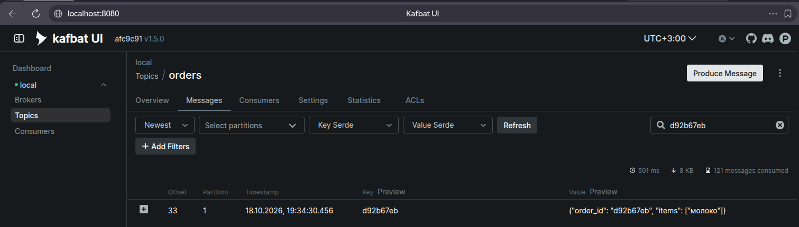

Заказ был найден в Kafka UI: 1 партиция 33 offset, что совпадает с информацией из user-service.

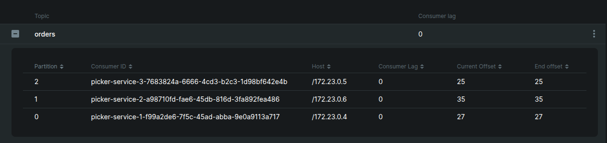

В партиции 1 явно видно, что заказ был принят на обработку: `consumer lag == 0`, `current offset (35) == end offset (35) > order offset (33)`.

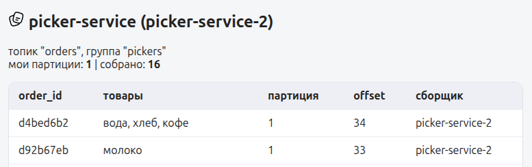

В picker-service убеждаемся, что заказ обработан.

### 5. Пересчёт истории для аналитики

Остановим сервисы сборщиков.

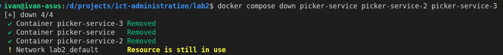

Зайдем на страницу управления consumers.

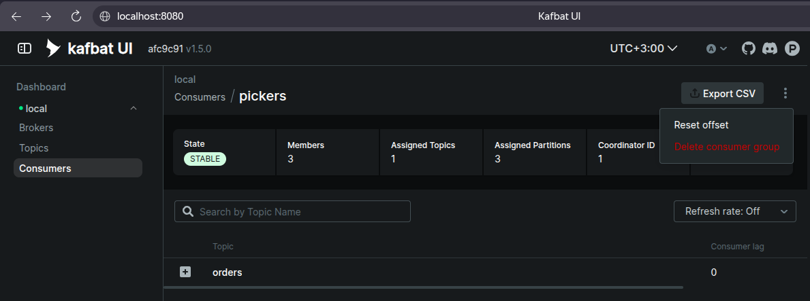

Сбросим offset'ы.

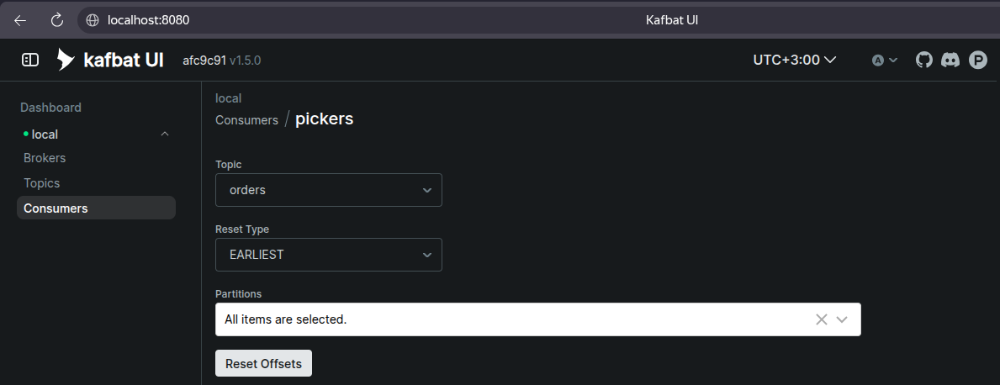

Зайдем на страницу управления топика orders и увидим огромный consumer lag.

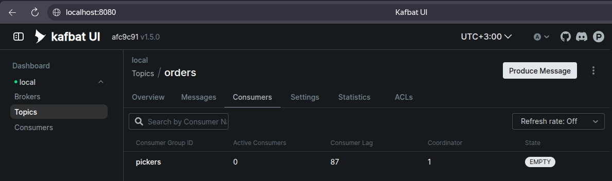

Запустим сервисы сборщиков.

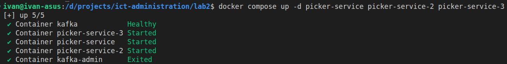

Спустя время обработки на странице топика orders увидим consumer lag равный 0.

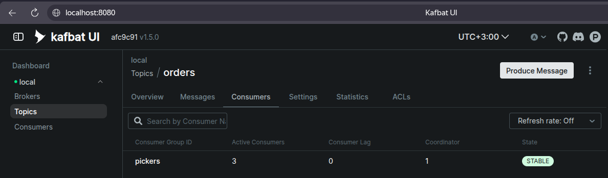

В Kafka сообщения хранятся в append-only логе и живут, пока не истечёт retention. При сбросе offset'ов мы просто переводим указатель в начало лога. Сборщики начинают обрабатывать все заказы заново.

В обычной очереди операция pop достает сообщение и удаляет его, поэтому перечитать их уже не получиться.

### 6. Диск заполняется старыми заказами
