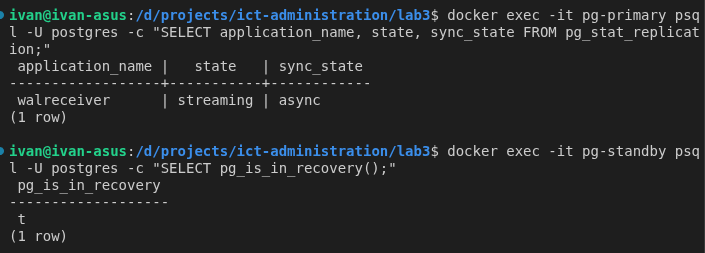

# Лаба 3 — Репликация базы данных: подними, сломай, восстанови

**Цель**: поднять репликацию базы данных, подключить к ней сервис, а затем увидеть отставание реплики (replication lag), связь с теоремой CAP и действия при отказе primary (failover).

## PostgreSQL — почему?

1. Мне реляционные таблицы дороже json-ов! После долгих ночей работы с динамической типизацией хочется чего-то стабильного.
2. В PostgreSQL можно контролировать процесс руками. В MongoDB failover происходит сам - подойдет, если захочется понаблюдать.
3. На предыдущих дисциплинах уже был опыт с PostgreSQL со стороны разработчиков и со стороны проектировщиков бд.

## Часть 1 — Поднятие репликации (через конфигурацию)

### Давайте разбираться

> Худая кобыла с места рвёт

Можно было б начинать, однако так сразу не получится, нужно устаканить плавающие знания.
Почитав статейки
([тут](https://dev.to/kalio/postgresql-read-replicas-with-docker-a-step-by-step-guide-1hil), [тут](https://medium.com/swlh/postgresql-replication-with-docker-c6a904becf77) и [тут](https://github.com/sun1211/postgresql-docker-replication)),
понимаем фронт работ и делаем выводы:

- **Репликация или шардирование?** Репликация - это полная копия (или несколько копий) объекта изучения, а шардирование делит данные между узлами. Их, естественно, можно комбинировать. В этой лабе мы не трогаем распределенное хранение, нам нужно только резервирование.
- **Резервирование или резервное копирование?** Тут тоже важно понимать разницу: резервирование подразумевает наличие горячего резерва, способного скорейшим образом подменить упавшую часть, а резервное копирование (бекапы) в результате получает простую копию, которую ещё нужно применить и запустить.
- **Физически или логически? Быть или казаться?** В контексте реплик, логическая реплика кажется копией оригинала, однако не обязательно её является, можно настраивать копирование лишь части таблиц, а также БД может быть запущена н адругой архитектуре. В лабе нужна физическая реплика - именно она позволит сделать отказоустойчивость.

Основная механика репликации работает на WAL (журнале предзаписи).
На выбор у нас два режима работы:

- **асинхронный** основная БД не ждет реплику, однако мы можем потерять данные между записью в WAL и чтением изменений из реплики,
- **синхронный** идет без потерь, но основной БД приходится ждать подтверждения реплики.

### Поработаем ручками

Сначала напишем конфигурацию основного сервера [`primary/postgresql.conf`](./config/primary/postgresql.conf). Здесь мы задаем асинхронный режим работы с одной репликой.

```conf
listen_addresses = '*'

# Включать полные изменения строк в WAL
wal_level = replica
# Разрешить до 1 одновременных подключений к репликации
max_wal_senders = 1
# Один слот (предотвращает преждевременное удаление WAL)
max_replication_slots = 1
# Хранить 256 МБ файлов WAL для отстающих реплик
wal_keep_size = 256

# Выполнять сброс на локальный диск перед подтверждением (не на реплику)
synchronous_commit = on

# Performance
shared_buffers = 256MB
work_mem = 4MB
checkpoint_completion_target = 0.9
```

Далее настройки входящих подключений основного сервера [`primary/pg_hba.conf`](./config/primary/pg_hba.conf). Здесь мы разрешаем подключаться реплике.

```conf
# Разрешить локальные подключения
local   all             all                                     trust
host    all             all             127.0.0.1/32            trust
host    all             all             ::1/128                 trust

# Разрешить реплике подключиться для репликации
host    replication     replicator      0.0.0.0/0               md5

# Разрешить подключения приложений из сети Docker
host    all             all             0.0.0.0/0               md5
```

Затем напишем конфигурацию реплики [`replica/postgresql.conf`](./config/replica/postgresql.conf). Тут просто указываем ей работать в режиме горячей репликации.

```conf
# Включить запросы на чтение при применении изменений WAL
hot_standby = on

#  Сообщает основному серверу, какие строки все еще нужны реплике
hot_standby_feedback = on

# Performance
shared_buffers = 256MB
work_mem = 4MB
```

Также необходим скрипт начальной инициализации реплики, который возьмет снимок основной БД ([`replica/replica-entrypoint.sh`](./config/replica/replica-entrypoint.sh)).

В итоге получаем слеующую структуру конфигурационных файлов.

```txt
config/
├── init/
│   ├── 01_init.sql
│   └── 02_schema.sql
├── primary/
│   ├── postgresql.conf
│   └── pg_hba.conf
└── replica/
    ├── postgresql.conf
    ├── pg_hba.conf
    └── replica-entrypoint.sh
```

Наконец, опишем весь стенд в [`docker-compose.yml`](./docker-compose.yml)

<details>
<summary>
    Конфигурация compose для связки primary + replica
</summary>

```yml
name: lab3

services:
    pg-primary:
        image: postgres:18.6
        container_name: pg-primary
        environment:
            POSTGRES_USER: postgres
            POSTGRES_PASSWORD: postgres
            POSTGRES_DB: postgres
        volumes:
            - primary-data:/var/lib/postgresql
            - ./config/primary/postgresql.conf:/etc/primary/postgresql.conf
            - ./config/primary/pg_hba.conf:/etc/primary/pg_hba.conf
            - ./config/init:/docker-entrypoint-initdb.d
        command: >
            postgres
              -c config_file=/etc/primary/postgresql.conf
              -c hba_file=/etc/primary/pg_hba.conf
        ports:
            - "5432:5432"
        healthcheck:
            test: ["CMD-SHELL", "pg_isready -h 0.0.0.0 -p 5432 -U postgres"]
            interval: 5s
            timeout: 5s
            retries: 15
            start_period: 10s

    pg-standby:
        image: postgres:18.6
        container_name: pg-standby
        user: postgres
        environment:
            PRIMARY_HOST: pg-primary
            POSTGRES_PASSWORD: postgres
        volumes:
            - standby-data:/var/lib/postgresql
            - ./config/replica/postgresql.conf:/etc/replica/postgresql.conf
            - ./config/replica/pg_hba.conf:/etc/replica/pg_hba.conf
            - ./config/replica/replica-entrypoint.sh:/replica-entrypoint.sh
        entrypoint: ["/bin/bash", "/replica-entrypoint.sh"]
        ports:
            - "5433:5432"
        depends_on:
            pg-primary:
                condition: service_healthy

volumes:
    primary-data:
    standby-data:
```

</details>

### Чинилы и запуск БД

#### Попытка запуска №1

> [!WARNING]
> Вылезает ошибка из-за смены структуры каталога данных в образе PostgreSQL 18 `Error: in 18+, these Docker images are configured`.
> Проблема решается сменой пути к данным на `/var/lib/postgresql/18/docker`.

#### Попытка запуска №2

> [!WARNING]
> Вылезает ошибка подключения реплики к оригиналу `number of requested standby connections exceeds "max_wal_senders" (currently 1)`.
> Проблема решается повышением числа подключений в конфиге `max_wal_senders = 3`.
> Проблема возникла, так как изначально я не знал, что одной реплике нужно несколько подключений и вписал единицу.

#### Попытка запуска №3

> [!WARNING]
> Вылезает ошибка реплики `cp: -r not specified; omitting directory '/etc/replica/pg_hba.conf'`.
> Проблема возникла, потому что я пытался примонтировать файл конфигурации подключений на реплике, но сам этот файл не создал: compose создал вместо него директорию.
> Проблема решается созданием примитивного [`replica/pg_hba.conf`](./config/replica/pg_hba.conf).

#### Попытка запуска №4

Оба сервера запустились без ошибок, для проверки репликаций были просмотрены следующие параметры.

- `pg-primary`: строка с `state` = `streaming`. Это доказывает, что репликация работает.
- `pg-standby`: строка `t`. Это доказывает, что standby работает как реплика, а не как отдельная база.



Далее проверим запись на primary и чтение с реплики.


## Часть 2 — Подключение подопытного сервиса
