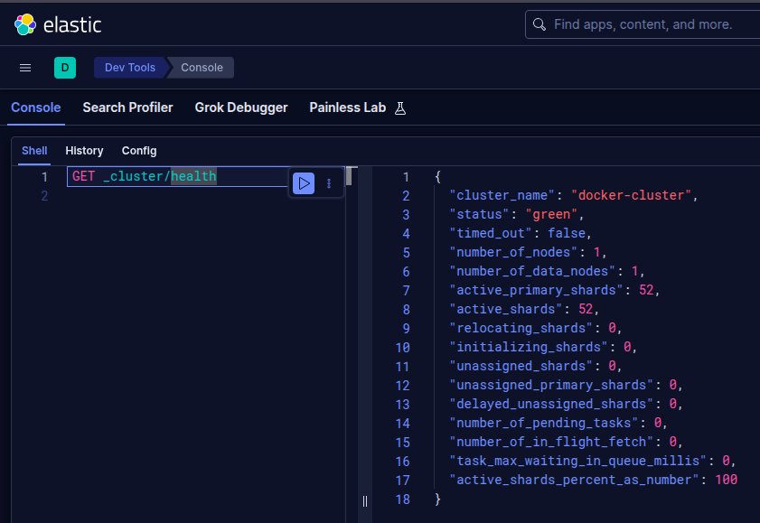

# Лаба 4 — Развернуть ELK и потрогать Эластик руками

**Цель**: поднять Elasticsearch + Kibana локально, залить логи приложения, научиться искать и агрегировать по ним, разобраться с шардами, репликами и статусом кластера и настроить минимальную ротацию (ILM + rollover). Всё локально, с демонстрацией, что работает.

## Часть 1 — Развернуть ELK локально

С помощью [документации](https://www.elastic.co/docs/deploy-manage/deploy/self-managed/install-elasticsearch-docker-compose) создадим конфигурацию для развертывания Elasticsearch и Kibana.

Найдем подходящие образы последней версии на [docker.elastic.co](https://www.docker.elastic.co/):

- `docker.elastic.co/elasticsearch/elasticsearch:9.5.6`,
- `docker.elastic.co/kibana/kibana-wolfi:9.5.6`.

> [!NOTE]
> Образы, конечно, большие: 916.7MB на Elasticsearch и 556.1MB на Kibana. Суммарно они заняли больше 5GB на диске. Меня это натолкнуло почистить и посмотреть images на машине. Prometheus стек во главе с Grafana весят столь же соизмеримо много. Интересно.

### Разворачиваем ELK в минимальной конфигурации

Упростим представленную конфигурацию до работы в single-node режиме без TLS и системных пользователей в [`docker-compose.yml`](./docker-compose.yml).

> [!WARNING]
> Попробуем открыть <http://localhost:5601/app/elasticsearch/home>, получаем "Unable to load page". Проблема в незащищенном подключении: некоторые функции просто отказываются работать.

Сгенерируем `KIBANA_ENCRYPTION_KEY` через `openssl rand -hex 32`, и пароли через `openssl rand -hex 8`, поместим их в [`.env`](.env):

```env
# Суперпользователь ES
ELASTIC_PASSWORD=...

# Для подключения Kibana к ES
KIBANA_ELASTICSEARCH_PASSWORD=...

# Для Kibana
KIBANA_ENCRYPTION_KEY=...
```

> [!NOTE]
> Да, `.env` нужно прятать в `.gitignore`, но я пренебрежительно оставлю его в угоду воспроизводимости без донастройки.

Поправим [`docker-compose.yml`](./docker-compose.yml), включив защищенный режим и добавив пользователей и пароли. Чтобы совсем не заморачиваться в Kibana для подключения передадим логин и пароль суперпользователя `elastic`.

```yml
services:
    es01:
        environment:
            - discovery.type=single-node
            - xpack.security.enabled=true
            - xpack.security.http.ssl.enabled=false
            - ELASTIC_PASSWORD=${ELASTIC_PASSWORD}
    kibana:
        environment:
            - ELASTICSEARCH_USERNAME=elastic
            - ELASTICSEARCH_PASSWORD=${ELASTIC_PASSWORD}
```

<details>
<summary>
    Конфигурация compose для Elasticsearch и Kibana
</summary>

```yml
name: lab4

services:
    es01:
        image: docker.elastic.co/elasticsearch/elasticsearch:9.5.6
        container_name: es01
        environment:
            - discovery.type=single-node
            - xpack.security.enabled=true
            - xpack.security.http.ssl.enabled=false
            - ELASTIC_PASSWORD=${ELASTIC_PASSWORD}
        ports:
            - 9200:9200
        volumes:
            - esdata01:/usr/share/elasticsearch/data
        mem_limit: 4g
        healthcheck:
            test:
                [
                    "CMD-SHELL",
                    "curl -fsS -u elastic:$$ELASTIC_PASSWORD http://localhost:9200 || exit 1",
                ]
            interval: 10s
            timeout: 10s
            retries: 120

    kibana:
        image: docker.elastic.co/kibana/kibana:9.5.6
        container_name: kibana
        environment:
            - ELASTICSEARCH_HOSTS=http://es01:9200
            - ELASTICSEARCH_USERNAME=elastic
            - ELASTICSEARCH_PASSWORD=${ELASTIC_PASSWORD}
            - XPACK_ENCRYPTEDSAVEDOBJECTS_ENCRYPTIONKEY=${KIBANA_ENCRYPTION_KEY}
        ports:
            - 5601:5601
        volumes:
            - kibanadata:/usr/share/kibana/data
        mem_limit: 4g
        depends_on:
            es-setup:
                condition: service_completed_successfully

volumes:
    esdata01:
    kibanadata:
```

</details>

### Разворачиваем ELK нормально

> [!NOTE]
> Легкие пути пугают: нет TLS, раздача прав суперпользователя.

Если используем готового системного пользователя `kibana_system`, его пароль Elasticsearch не знает. Вручную это решается через установку пароля `docker exec -it es01 bin/elasticsearch-reset-password -u kibana_system -i`. А с сертификатами работы и того больше.

Чтобы самому не мучаться с настройкой сертификатов и прав, вернемся к [документации](https://www.elastic.co/docs/deploy-manage/deploy/self-managed/install-elasticsearch-docker-compose) и позаимствуем оттуда часть setup сервиса. Все-таки нам все ещё не нужен целый кластер.

Поменяв всякие настроечки получаем [`docker-compose.yml`](./docker-compose.yml) и скрипт инициализации [`es-setup.sh`](./es-setup.sh), который создает сертификаты для Elasticsearch, ждет его включения и создает системного пользователя для Kibana.

<details>
<summary>
    Конфигурация compose для Elasticsearch и Kibana
</summary>

```yml
name: lab4

services:
    es-setup:
        image: docker.elastic.co/elasticsearch/elasticsearch:9.5.6
        container_name: es-setup
        environment:
            - ELASTIC_PASSWORD=${ELASTIC_PASSWORD}
            - KIBANA_ELASTICSEARCH_PASSWORD=${KIBANA_ELASTICSEARCH_PASSWORD}
        user: "0"
        command: ["bash", "/usr/local/bin/es-setup.sh"]
        volumes:
            - certs:/usr/share/elasticsearch/config/certs
            - ./es-setup.sh:/usr/local/bin/es-setup.sh:ro
        healthcheck:
            test: ["CMD-SHELL", "[ -f config/certs/es01/es01.crt ]"]
            interval: 1s
            timeout: 5s
            retries: 120
        restart: "no"

    es01:
        image: docker.elastic.co/elasticsearch/elasticsearch:9.5.6
        container_name: es01
        depends_on:
            es-setup:
                condition: service_healthy
        environment:
            - node.name=es01
            - discovery.type=single-node
            - ELASTIC_PASSWORD=${ELASTIC_PASSWORD}
            - xpack.security.enabled=true
            - xpack.security.http.ssl.enabled=true
            - xpack.security.http.ssl.key=certs/es01/es01.key
            - xpack.security.http.ssl.certificate=certs/es01/es01.crt
            - xpack.security.http.ssl.certificate_authorities=certs/ca/ca.crt
            - xpack.security.transport.ssl.enabled=true
            - xpack.security.transport.ssl.key=certs/es01/es01.key
            - xpack.security.transport.ssl.certificate=certs/es01/es01.crt
            - xpack.security.transport.ssl.certificate_authorities=certs/ca/ca.crt
            - xpack.security.transport.ssl.verification_mode=certificate
        ports:
            - 9200:9200
        volumes:
            - certs:/usr/share/elasticsearch/config/certs
            - esdata01:/usr/share/elasticsearch/data
        mem_limit: 4g
        healthcheck:
            test:
                [
                    "CMD-SHELL",
                    "curl -s --cacert config/certs/ca/ca.crt https://localhost:9200 | grep -q 'missing authentication credentials'",
                ]
            interval: 10s
            timeout: 10s
            retries: 120

    kibana:
        image: docker.elastic.co/kibana/kibana:9.5.6
        container_name: kibana
        depends_on:
            es-setup:
                condition: service_completed_successfully
            es01:
                condition: service_healthy
        environment:
            - SERVERNAME=kibana
            - ELASTICSEARCH_HOSTS=https://es01:9200
            - ELASTICSEARCH_USERNAME=kibana_system
            - ELASTICSEARCH_PASSWORD=${KIBANA_ELASTICSEARCH_PASSWORD}
            - ELASTICSEARCH_SSL_CERTIFICATEAUTHORITIES=config/certs/ca/ca.crt
            - XPACK_ENCRYPTEDSAVEDOBJECTS_ENCRYPTIONKEY=${KIBANA_ENCRYPTION_KEY}
        ports:
            - 5601:5601
        volumes:
            - certs:/usr/share/kibana/config/certs:ro
            - kibanadata:/usr/share/kibana/data
        mem_limit: 4g

volumes:
    certs:
    esdata01:
    kibanadata:
```

</details>

### Проверяем результат

Откроем <http://localhost:5601/app/dev_tools#/console/shell>, исполним запрос `GET _cluster/health`: Elasticsearch работает c `GREEN`.



Статус `"green"` говорит о том, что все первичные шарды и реплики размещены и работают. Так как установлен режим `single-node`, эластик запускается в одном экземпляре с 0 реплик, а если реплицироваться никуда не нужно, значит, все в порядке.

## Часть 2 — Данные, индекс и поиск
