# Лаба 4 — Развернуть ELK и потрогать Эластик руками

**Цель**: поднять Elasticsearch + Kibana локально, залить логи приложения, научиться искать и агрегировать по ним, разобраться с шардами, репликами и статусом кластера и настроить минимальную ротацию (ILM + rollover). Всё локально, с демонстрацией, что работает.

## Часть 1 — Развернуть ELK локально

С помощью [документации](https://www.elastic.co/docs/deploy-manage/deploy/self-managed/install-elasticsearch-docker-compose) создадим конфигурацию для развертывания Elasticsearch и Kibana.

Найдем подходящие образы последней версии на [docker.elastic.co](https://www.docker.elastic.co/):

- `docker.elastic.co/elasticsearch/elasticsearch:9.5.6`,
- `docker.elastic.co/kibana/kibana:9.5.6`.

> [!NOTE]
> Образы, конечно, большие: 916.7MB на Elasticsearch и 556.1MB на Kibana. Суммарно они заняли больше 5GB на диске. Меня это натолкнуло почистить и посмотреть images на машине. Prometheus стек во главе с Grafana весят столь же соизмеримо много. Интересно.

### Разворачиваем ELK в минимальной конфигурации

Упростим представленную конфигурацию до работы в single-node режиме без TLS и системных пользователей в [`docker-compose.yml`](./docker-compose.yml).

> [!WARNING]
> Попробуем открыть <http://localhost:5601/app/elasticsearch/home>, получаем "Unable to load page". Проблема в незащищенном подключении: некоторые функции просто отказываются работать.

Сгенерируем `KIBANA_ENCRYPTION_KEY` через `openssl rand -hex 32`, и пароли через `openssl rand -hex 8`, поместим их в [`.env`](.env):

```env
# Суперпользователь ES
ELASTIC_PASSWORD=...

# Для подключения Kibana к ES
KIBANA_ELASTICSEARCH_PASSWORD=...

# Для Kibana
KIBANA_ENCRYPTION_KEY=...
```

> [!NOTE]
> Да, `.env` нужно прятать в `.gitignore`, но я пренебрежительно оставлю его в угоду воспроизводимости без донастройки.

Поправим [`docker-compose.yml`](./docker-compose.yml), включив защищенный режим и добавив пользователей и пароли. Чтобы совсем не заморачиваться в Kibana для подключения передадим логин и пароль суперпользователя `elastic`.

```yml
services:
    es01:
        environment:
            - discovery.type=single-node
            - xpack.security.enabled=true
            - xpack.security.http.ssl.enabled=false
            - ELASTIC_PASSWORD=${ELASTIC_PASSWORD}
    kibana:
        environment:
            - ELASTICSEARCH_USERNAME=elastic
            - ELASTICSEARCH_PASSWORD=${ELASTIC_PASSWORD}
```

<details>
<summary>
    Конфигурация compose для Elasticsearch и Kibana
</summary>

```yml
name: lab4

services:
    es01:
        image: docker.elastic.co/elasticsearch/elasticsearch:9.5.6
        container_name: es01
        environment:
            - discovery.type=single-node
            - xpack.security.enabled=true
            - xpack.security.http.ssl.enabled=false
            - ELASTIC_PASSWORD=${ELASTIC_PASSWORD}
        ports:
            - 9200:9200
        volumes:
            - esdata01:/usr/share/elasticsearch/data
        mem_limit: 4g
        healthcheck:
            test:
                [
                    "CMD-SHELL",
                    "curl -fsS -u elastic:$$ELASTIC_PASSWORD http://localhost:9200 || exit 1",
                ]
            interval: 10s
            timeout: 10s
            retries: 120

    kibana:
        image: docker.elastic.co/kibana/kibana:9.5.6
        container_name: kibana
        environment:
            - ELASTICSEARCH_HOSTS=http://es01:9200
            - ELASTICSEARCH_USERNAME=elastic
            - ELASTICSEARCH_PASSWORD=${ELASTIC_PASSWORD}
            - XPACK_ENCRYPTEDSAVEDOBJECTS_ENCRYPTIONKEY=${KIBANA_ENCRYPTION_KEY}
        ports:
            - 5601:5601
        volumes:
            - kibanadata:/usr/share/kibana/data
        mem_limit: 4g
        depends_on:
            es01:
                condition: service_healtly

volumes:
    esdata01:
    kibanadata:
```

</details>

### Разворачиваем ELK нормально

> [!NOTE]
> Легкие пути пугают: нет TLS, раздача прав суперпользователя.

Если используем готового системного пользователя `kibana_system`, его пароль Elasticsearch не знает. Вручную это решается через установку пароля `docker exec -it es01 bin/elasticsearch-reset-password -u kibana_system -i`. А с сертификатами работы и того больше.

Чтобы самому не мучаться с настройкой сертификатов и прав, вернемся к [документации](https://www.elastic.co/docs/deploy-manage/deploy/self-managed/install-elasticsearch-docker-compose) и позаимствуем оттуда часть setup сервиса. Все-таки нам все ещё не нужен целый кластер.

Поменяв всякие настроечки получаем [`docker-compose.yml`](./docker-compose.yml) и скрипт инициализации [`es-setup.sh`](./es-setup.sh), который создает сертификаты для Elasticsearch, ждет его включения и задает пароль системного пользователя для Kibana.

<details>
<summary>
    Конфигурация compose для Elasticsearch и Kibana
</summary>

```yml
name: lab4

services:
    es-setup:
        image: docker.elastic.co/elasticsearch/elasticsearch:9.5.6
        container_name: es-setup
        environment:
            - ELASTIC_PASSWORD=${ELASTIC_PASSWORD}
            - KIBANA_ELASTICSEARCH_PASSWORD=${KIBANA_ELASTICSEARCH_PASSWORD}
        user: "0"
        command: ["bash", "/usr/local/bin/es-setup.sh"]
        volumes:
            - certs:/usr/share/elasticsearch/config/certs
            - ./es-setup.sh:/usr/local/bin/es-setup.sh:ro
        healthcheck:
            test: ["CMD-SHELL", "[ -f config/certs/es01/es01.crt ]"]
            interval: 1s
            timeout: 5s
            retries: 120
        restart: "no"

    es01:
        image: docker.elastic.co/elasticsearch/elasticsearch:9.5.6
        container_name: es01
        depends_on:
            es-setup:
                condition: service_healthy
        environment:
            - node.name=es01
            - discovery.type=single-node
            - ELASTIC_PASSWORD=${ELASTIC_PASSWORD}
            - xpack.security.enabled=true
            - xpack.security.http.ssl.enabled=true
            - xpack.security.http.ssl.key=certs/es01/es01.key
            - xpack.security.http.ssl.certificate=certs/es01/es01.crt
            - xpack.security.http.ssl.certificate_authorities=certs/ca/ca.crt
            - xpack.security.transport.ssl.enabled=true
            - xpack.security.transport.ssl.key=certs/es01/es01.key
            - xpack.security.transport.ssl.certificate=certs/es01/es01.crt
            - xpack.security.transport.ssl.certificate_authorities=certs/ca/ca.crt
            - xpack.security.transport.ssl.verification_mode=certificate
        ports:
            - 9200:9200
        volumes:
            - certs:/usr/share/elasticsearch/config/certs
            - esdata01:/usr/share/elasticsearch/data
        mem_limit: 4g
        healthcheck:
            test:
                [
                    "CMD-SHELL",
                    "curl -s --cacert config/certs/ca/ca.crt https://localhost:9200 | grep -q 'missing authentication credentials'",
                ]
            interval: 10s
            timeout: 10s
            retries: 120

    kibana:
        image: docker.elastic.co/kibana/kibana:9.5.6
        container_name: kibana
        depends_on:
            es-setup:
                condition: service_completed_successfully
            es01:
                condition: service_healthy
        environment:
            - SERVERNAME=kibana
            - ELASTICSEARCH_HOSTS=https://es01:9200
            - ELASTICSEARCH_USERNAME=kibana_system
            - ELASTICSEARCH_PASSWORD=${KIBANA_ELASTICSEARCH_PASSWORD}
            - ELASTICSEARCH_SSL_CERTIFICATEAUTHORITIES=config/certs/ca/ca.crt
            - XPACK_ENCRYPTEDSAVEDOBJECTS_ENCRYPTIONKEY=${KIBANA_ENCRYPTION_KEY}
        ports:
            - 5601:5601
        volumes:
            - certs:/usr/share/kibana/config/certs:ro
            - kibanadata:/usr/share/kibana/data
        mem_limit: 4g

volumes:
    certs:
    esdata01:
    kibanadata:
```

</details>

### Проверяем результат

Откроем <http://localhost:5601/app/dev_tools#/console/shell>, исполним запрос `GET _cluster/health`: Elasticsearch работает с `GREEN`.


Статус `GREEN` говорит о том, что все первичные шарды и реплики размещены и работают. Так как установлен режим `single-node`, эластик запускается в одном экземпляре с системными индексами, которым реплики не нужны, а если реплицироваться никуда не нужно, значит, все в порядке.

## Часть 2 — Данные, индекс и поиск

### Ищем логи

> Настоящего приложения у нас нет, поэтому тестовые логи сгенерируй сам.

А ведь у меня как раз есть [бекендик](https://reviews.work.gd/docs), который крутится и активно отдает данные, я держу его как домашнего питомца на удаленном сервере. Заглянув в него, обнаружил логи за последние два месяца и сохранил их (`docker compose logs backend > backend.log`). Логирование там безобразное, разношерстное.

Для нужд лабораторной работы был произведен жесточайший вайб-скрипт, который cгенерировал по реальным грязным данным красивенькие.

- `timestamp` — лишь у части логов можно посмотреть их время, однако нас спасут метрики: каждый 15 секунд prometheus их собирает и по тактированию запросов /metrics можно поставить на логи их приблизительное время (в конечном файле 347549 записей /metrics было пропущено);
- `service` — логи сервиса инсайтов и uvicorn различаются: именно на этом различии и будем раздать метки имени сервиса;
- `level` и `message` — просто копируем;
- `trace_id` генерируем случайный uuid.

В итоге получился [`logs_bulk.ndjson`](./logs_bulk.ndjson) на `215549` записей.

### Создание индекса

Находим простую [инструкцию](https://www.elastic.co/docs/solutions/search/get-started/index-basics) по добавлению данных. Создадим простой индекс: 5 полей как в логах, без динамической индексации.

```json
PUT logs-test
{
  "mappings": {
    "dynamic": false,
    "properties": {
      "timestamp": { "type": "date" },
      "level":     { "type": "keyword" },
      "service":   { "type": "keyword" },
      "message":   { "type": "text" },
      "trace_id":  { "type": "keyword" }
    }
  }
}
```

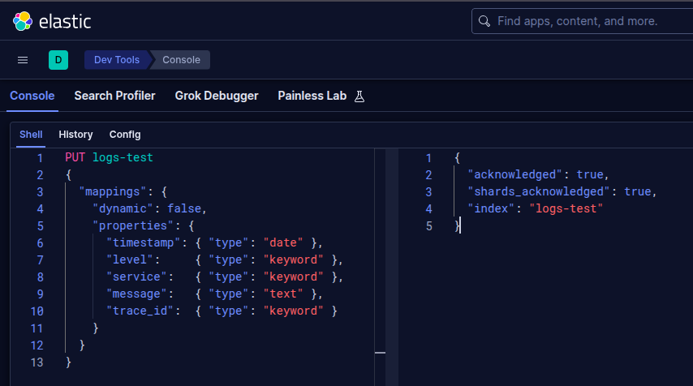

> [!WARNING]
> С первой попытки создать индекс не получилось, изначально придуманное имя `logs-app-test` подходило под встроенный шаблон для потока логов. Переименовал в `logs-test`.

### Загрузка логов в индекс

Загрузить 215 тысяч логов вручную? Заманчиво. Но, пожалуй, загрузим весь файл через Bulk API.

Сначала достанем сертификат для взаимодействия с Эластиком.

```bash
docker cp es01:/usr/share/elasticsearch/config/certs/ca/ca.crt ./ca.crt
```

Загрузим переменную пароля от Эластика в сессию.

```bash
ELASTIC_PASSWORD=$(grep '^ELASTIC_PASSWORD=' .env | cut -d= -f2-)
```

Наконец, загрузим логи.

```bash
curl --cacert ca.crt -u elastic:$ELASTIC_PASSWORD \
-H "Content-Type: application/x-ndjson" \
-X POST https://localhost:9200/_bulk \
--data-binary @logs_bulk.ndjson
```

Elasticsearch работает с `YELLOW`, потому что не может создать реплику созданного индекса, ведь имеется всего одна нода, а делать реплику на той же ноде нет смысла.

Для исправления на `GREEN` зададим

```json
PUT logs-test/_settings
{
    "index": { "number_of_replicas": 0 }
}
```

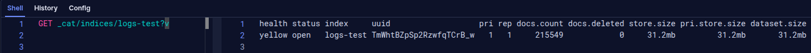
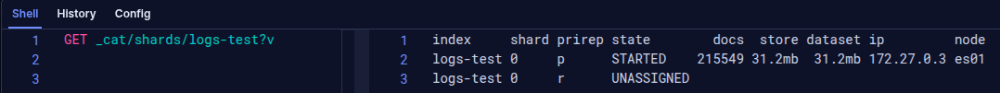

### Выполнение разнообразных запросов

#### Полнотекстовый поиск по `message`

Здесь `track_total_hits` заставляет Эластик считать точное количество вхождений, `size` указывает, что нужно вернуть только одно попадание (самое подходящее). Параметр `match` сообщает о неточном совпадении по полю.

```json
GET logs-test/_search
{
  "track_total_hits": true,
  "size": 1,
  "query": {
    "match": { "message": "Failed" }
  }
}
```

Было найдено 24 сообщения содержащих `Failed`. Все они связаны с ошибками сервиса инсайтов.


#### Фильтр по `level = ERROR` и по временно́му диапазону

Здесь используется `sort` по дате и `bool/filter` для нахождения всех ошибок 3 сентября.

```json
GET logs-test/_search
{
  "track_total_hits": true,
  "size": 10,
  "sort": [{ "timestamp": "asc" }],
  "query": {
    "bool": {
      "filter": [
        { "term": { "level": "ERROR" } },
        { "range":
            { "timestamp":
                {
                    "gte": "2026-09-03T00:00:00",
                    "lte": "2026-09-04T00:00:00"
                }
            }
        }
      ]
    }
  }
}
```

Было найдено 4 сообщения с ошибкой за 3 сентября. Все они связаны с ошибками сервиса инсайтов. Первый лог говорит об ошибке валидации, что нормально время от времени получать по API текстовых GPT моделей.


#### Поиск по конкретному `trace_id`

Для поиска был взят uuid из прошлого запроса. Параметр `term` используется для точного совпадения по полю.

```json
GET logs-test/_search
{
  "query": {
    "term": { "trace_id": "87e777b0-1656-4c2d-95f1-5f54860502d3" }
  }
}
```

Вернулся ожидаемый лог.


#### Агрегация: число WARN-логов

Поле `"size": 0` указывает, что не нужно возвращать совпадения.

```json
GET logs-test/_search
{
  "size": 0,
  "aggs": {
    "warn_count": {
      "filter": { "term": { "level": "WARN" } }
    }
  }
}
```

Получаем `93875` логов агрегации `warn_count`. Это свидетельствует о большом количестве неверных запросов, скорее всего, от поисковых и прочих ботов.

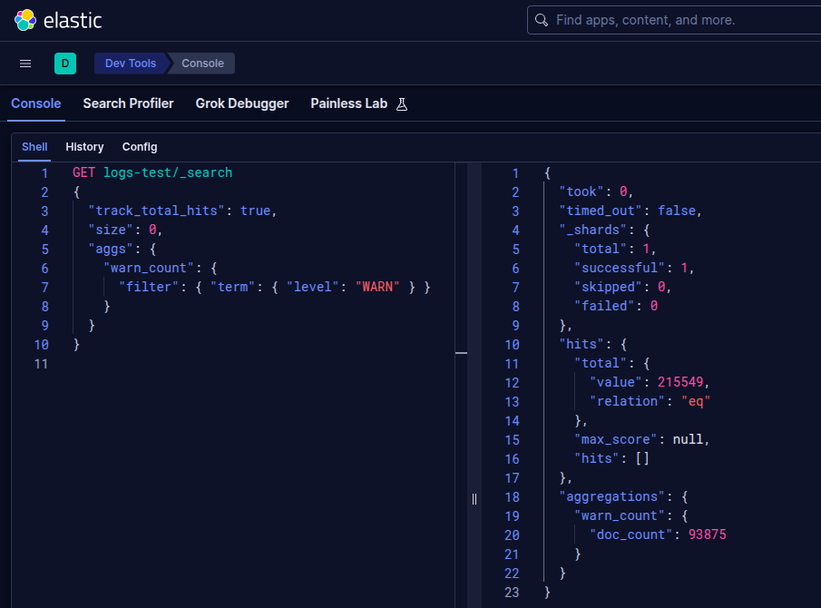

#### Агрегация: число логов сервиса insight

Аналогичный предыдущему запрос, но агрегируем как `"service": "insight"`.

```json
GET logs-test/_search
{
  "size": 0,
  "aggs": {
    "insight_count": {
      "filter": { "term": { "service": "insight" } }
    }
  }
}
```

Получаем `172` лога агрегации `insight_count`. Это говорит, что большая часть приходится на uvicorn.

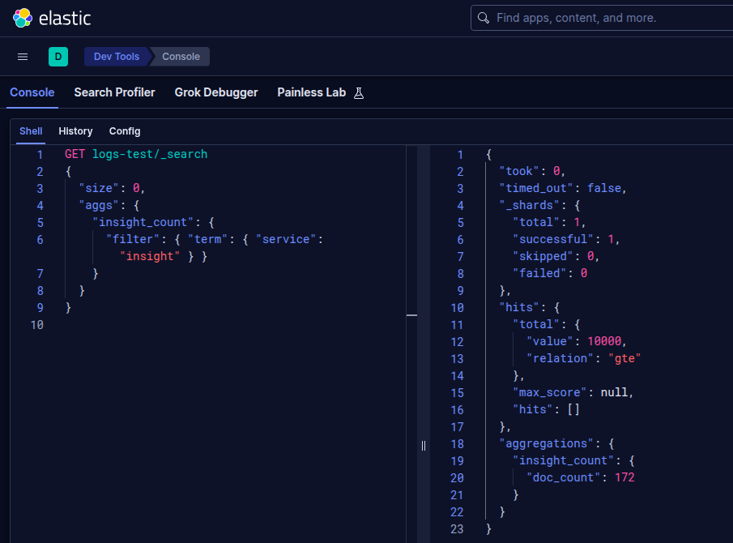

### Визуализация в Kibana

> [!NOTE]
> Не совсем понял, как и куда тыкать, все-таки вижу интерфейс впервые. Поэтому все действия части в вне консоли в Kibana были по инструкции чатика.

#### Создаем Data View

Заходим в Menu → Stack Management → Data Views. Создаем Data View для logs-test.

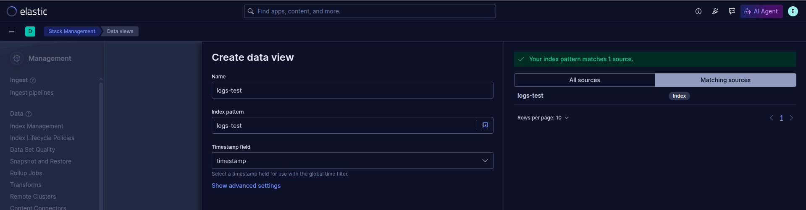

Получаем Data View, который будем использовать дальше.

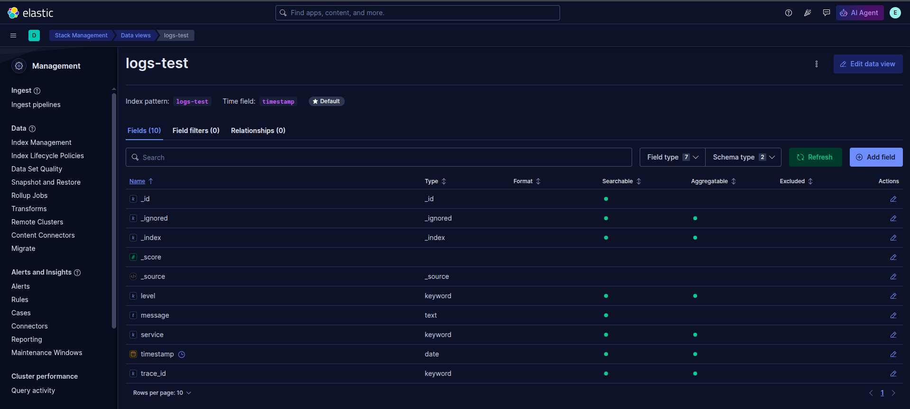

#### Смотрим данные в Discover

Заходим в Menu → Discover. Выбираем data view `logs-test`, промежуток времени. Видим, что данные отображаются.

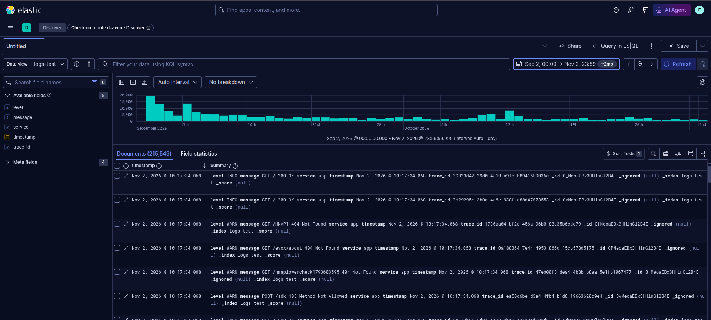

Проверяем возможность фильтрации на примере `level : "ERROR"`.


#### Строим столбики по level

Заходим в Menu → Visualize Library → Create visualization → Visualization.

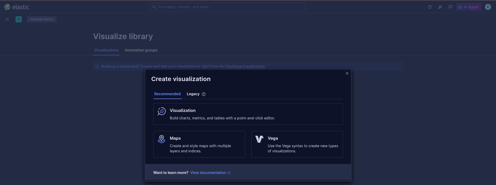

Перетащим столбик index в центр, получаем визуализацию.

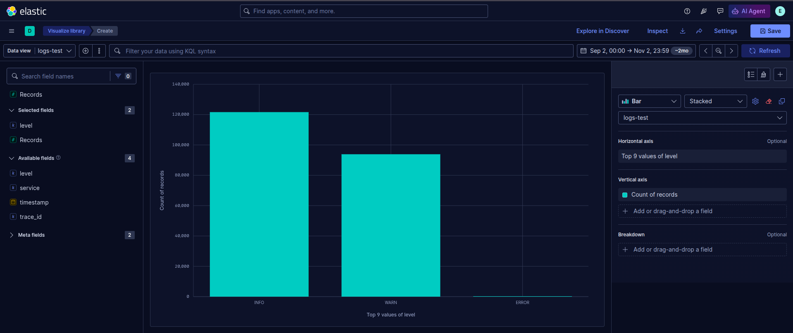

Сохраняем её как `Logs by level` в новый дашборд.

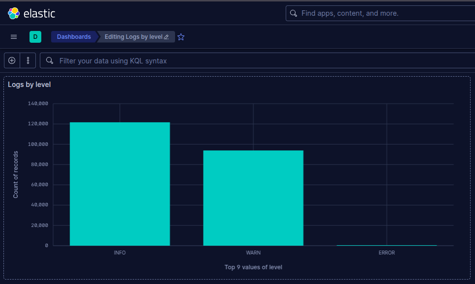

> [!NOTE]
> Можно сказать, что `WARN` очень много, но судя по форматам запросов, все это - поисковые боты.

## Часть 3 — Минимальный ILM + rollover

Для этой части выберем именование: для алиаса `app-logs`, для политики `app-logs-policy`. Индексы будут обозначаться как `app-logs-00000X`, их шаблон `app-logs-template`.

### Создание ILM политики

В созданной политике жизненный цикл логов для тестовой среды:

- `hot` - активный, пока для `rollover` не насобирается 1000 документов или не пройдет 1 день;
- `warm` - спустя 2 минуты после `rollover` ставим логи только для чтения, устанавливаем приоритет хранения, дополнительно отключаем миграции, так как имеем всего одну ноду;
- `cold` - спустя 4 минуты после `rollover` снижаем приоритет хранения до 0;
- `delete` - спустя 6 минут после `rollover` удаляем индекс.

```json
PUT _ilm/policy/app-logs-policy
{
  "policy": {
    "phases": {
      "hot": {
        "actions": {
          "rollover": {
            "max_age": "1d",
            "max_docs": 1000
          }
        }
      },
      "warm": {
        "min_age": "2m",
        "actions": {
          "migrate": { "enabled": false },
          "set_priority": { "priority": 50 },
          "readonly": {},
          "forcemerge": { "max_num_segments": 1 }
        }
      },
      "cold": {
        "min_age": "4m",
        "actions": {
          "set_priority": { "priority": 0 }
        }
      },
      "delete": {
        "min_age": "6m",
        "actions": { "delete": {} }
      }
    }
  }
}
```

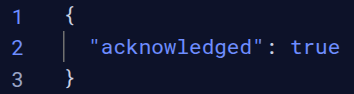

Затем создаем шаблон индекса `app-logs-*`, привязываем к нему созданную политику, задаем alias `app-logs`.

```json
PUT _index_template/app-logs-template
{
  "index_patterns": ["app-logs-*"],
  "template": {
    "settings": {
      "number_of_shards": 1,
      "number_of_replicas": 0,
      "index.lifecycle.name": "app-logs-policy",
      "index.lifecycle.rollover_alias": "app-logs"
    },
    "mappings": {
      "properties": {
        "timestamp": { "type": "date" },
        "level":     { "type": "keyword" },
        "service":   { "type": "keyword" },
        "message":   { "type": "text" },
        "trace_id":  { "type": "keyword" }
      }
    }
  }
}
```


Создаем первый индекс с alias, задаем на него флаг `is_write_index`.

```json
PUT app-logs-000001
{
  "aliases": {
    "app-logs": { "is_write_index": true }
  }
}
```

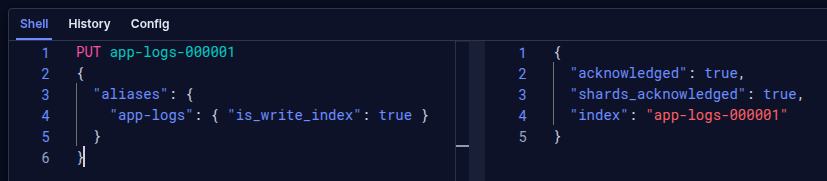

Проверяем состояние `GET _alias/app-logs`.

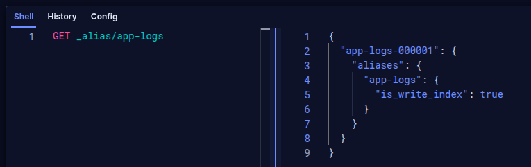

### Наблюдение за работой ILM

#### Подготовка

По умолчанию проверка состояний индексов идет раз в 10 минут, сократим до 5 секунд.

```json
PUT _cluster/settings
{
  "persistent": { "indices.lifecycle.poll_interval": "5s" }
}
```

Достанем сертификат для взаимодействия с Эластиком.

```bash
docker cp es01:/usr/share/elasticsearch/config/certs/ca/ca.crt ./ca.crt
```

Загрузим переменную пароля от Эластика в сессию.

```bash
ELASTIC_PASSWORD=$(grep '^ELASTIC_PASSWORD=' .env | cut -d= -f2-)
```

Достанем из [`logs_bulk.ndjson`](./logs_bulk.ndjson) **3 чанка по 1000 записей** (одна запись о логе занимает 2 строчки):

```bash
head -n 6000 logs_bulk.ndjson | split -l 2000 - log_chunks/chunk_
```

##### До загрузки

Для просмотра текущего состояния будем использовать набор запросов:

- состояния индексов;
- состояние алиаса;
- состояние политики.

```txt
GET _cat/indices/app-logs*?v
GET _alias/app-logs
GET app-logs-*/_ilm/explain?filter_path=indices.*.index,indices.*.managed,indices.*.phase,indices.*.action,indices.*.step
```


#### Загружаем первый чанк

Загрузим первые 1000 записей.

```bash
curl --cacert ca.crt -u elastic:$ELASTIC_PASSWORD \
-H "Content-Type: application/x-ndjson" \
-X POST https://localhost:9200/_bulk \
--data-binary @log_chunks/chunk_aa.ndjson
```

Флаг `is_write_index` перешел на следующий индекс, а первый помечен `completed`.

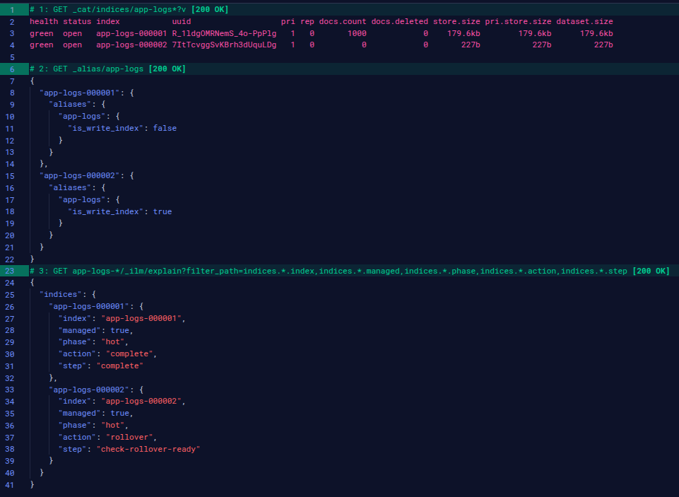

#### Загружаем второй чанк

Пока пишем результаты в отчет, первый индекс переходит в стадию `warm`, а затем и в `cold`. Так как в чанках по 1000 логов, то новый индекс создается после загрузки каждого чанка.

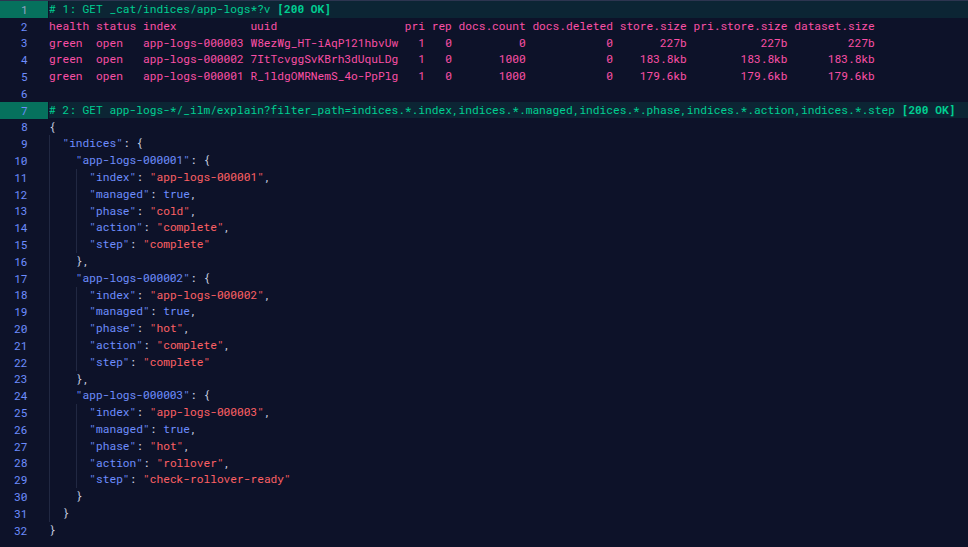

#### Загружаем третий чанк

После загрузки третьего чанка дожидаемся, пока все четыре индекса перейдут в разные состояния. В какой-то момент первый индекс был с пометкой `deleted`, видимо в это время он удалялся, но затем он полностью пропал из ответов.

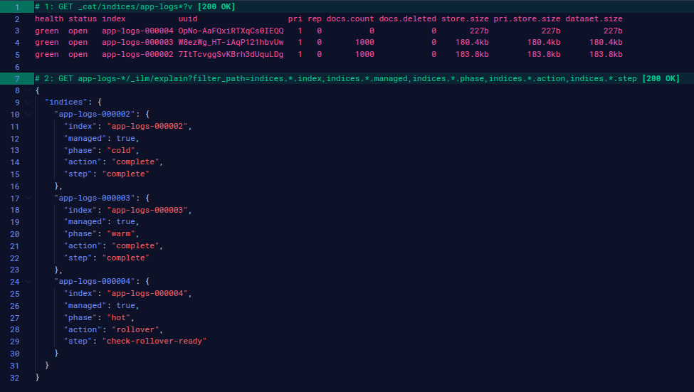

#### Спустя длительное время

Немного подождав, снова посмотрим на состояние индексов, все они, кроме текущего, удалились согласно политике.

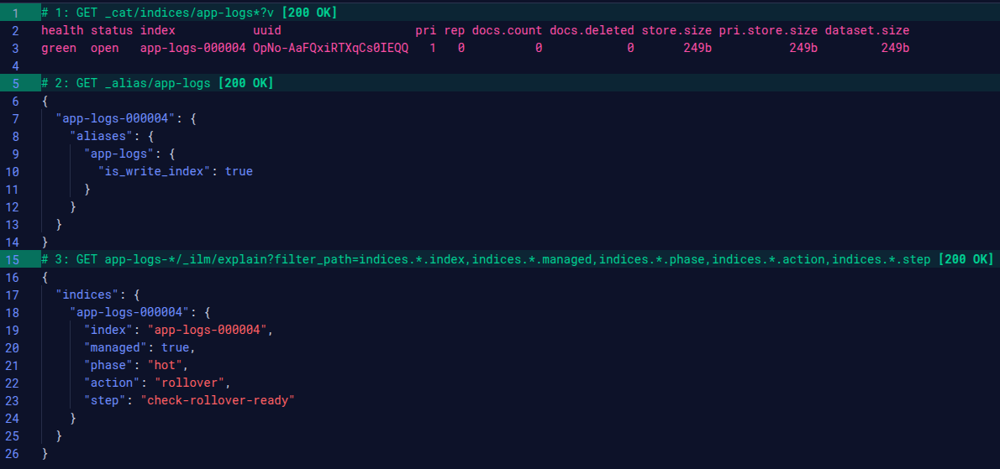

## Часть 4 — Мониторинг

> [!NOTE]
> ELK используется для мониторинга, поэтому я поузнавал, насколько легко реализуемо это решение. В ранних версиях ELK есть встроенный мониторинг, однако он признан устаревшим. Вариант с отдельным `Metricbeat` хорош, но идея наблюдать состояние сервиса через сам сервис не кажется надежной. Поэтому я решил проводить наблюдение за сервисом вновь через Prometheus + Grafana.

Настраиваем конфигурацию для мониторинга в [`docker-compose.yml`](./docker-compose.yml) и [`monitoring/`](./monitoring/). Для получения метрик используем экспортер образа `quay.io/prometheuscommunity/elasticsearch-exporter:v1.11.0`.

### Метрики

Выделим метрики, и отобразим их в дашборде, сохраним в [`monitoring/dashboards/main-dashboard.json`](./monitoring/dashboards/main-dashboard.json).

1. Статус кластера
    - Текущий статус кластера: `0=nodata`, `1=green`, `2=yellow`, `3=red`.
    - `(sum(elasticsearch_cluster_health_status{color="green"}) * 1 + sum(elasticsearch_cluster_health_status{color="yellow"}) * 2 + sum(elasticsearch_cluster_health_status{color="red"}) * 3) or vector(-1)`

2. Узлов в кластере
    - Число живых узлов в кластере, в нашем случае для single-node это 0 или 1.
    - `sum(elasticsearch_cluster_health_number_of_nodes)`

3. Неразмещенных и активных шардов
    - Статус репликации, чтобы быстро понимать причины yellow.
    - `sum(elasticsearch_cluster_health_unassigned_shards)`
    - `sum(elasticsearch_cluster_health_active_shards)`

4. Свободное место на диске
    - Состояние и запас хранилища
    - `100 * sum(elasticsearch_filesystem_data_available_bytes) / sum(elasticsearch_filesystem_data_size_bytes)`

5. Использование JVM heap
    - Состояние и запас оперативки для выделенной под JVM
    - `100 * sum(elasticsearch_jvm_memory_used_bytes{area="heap"}) / sum(elasticsearch_jvm_memory_max_bytes{area="heap"})`

6. Загрузка CPU узла
    - Запас по мощности CPU
    - `sum(elasticsearch_os_cpu_percent)`

7. Индексация (операций/с)
    - Нагрузка по индексации
    - `sum(rate(elasticsearch_indices_indexing_index_total[1m]))`

8. Поиск (запросов/с)
    - Нагрузка по поиску
    - `sum(rate(elasticsearch_indices_search_query_total[1m]))`

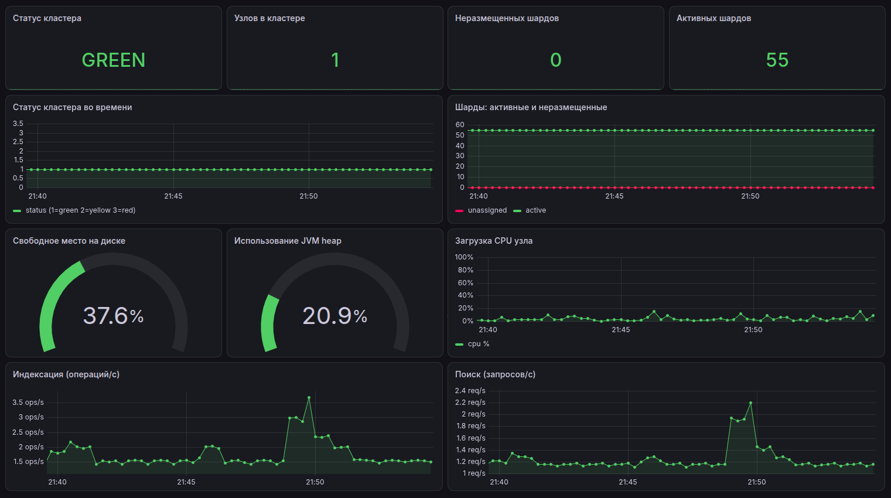

### Алерты

Опишем алерты в [`alert-rules.yml`](./monitoring/alert-rules.yml).

- `ClusterHealthDown` (critical). Срабатывает, когда прометеус не видит экспортер или экспортер не видит узлов кластера. Либо упал узел, либо оборвалась связь. В любом случае мы буквально слепнем.
- `ClusterHealthRed` (critical). Срабатывает, когда недоступна часть шардов. Сервисы физически не могут получить часть данных.
- `ClusterHealthYellow` (warning). Срабатывает, когда не размещена хотя бы одна реплика. Если единственный шард без реплик упадет, доступ к данным будет утерян.
- `ElasticsearchHeapHigh` (warning). Heap заполнен больше 85% - JVM начинает чаще запускать сборку мусора, это забирает CPU и увеличивает задержки. При почти полном заполнении Elasticsearch начинает отклонять запросы CircuitBreakingException. При полном заполнении возможен OutOfMemoryError и падение узла.
- `ElasticsearchDiskLow` (warning). Хранилище занято больше 85% (low watermark) - узел перестаёт получать новые шарды. При 90% (high watermark) начинается перенос шардов с этого узла. При 95% (flood stage) индексы переводятся в режим только для чтения.

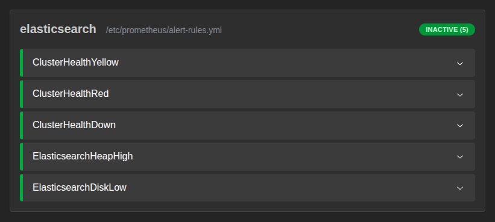

#### Вызовем `ClusterHealthYellow`

Для этого поднимем необходимое число реплик на одном из индексов до 1.

```json
PUT logs-test/_settings
{
    "index": { "number_of_replicas": 1 }
}
```

Через несколько секунд видим состояние на дашборде.

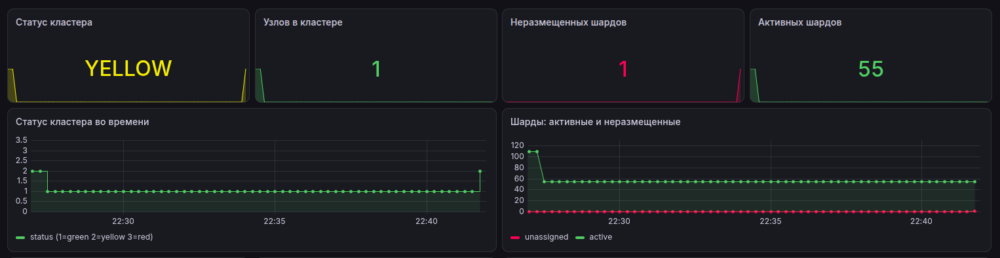

Через 2 минуты видим алерт.

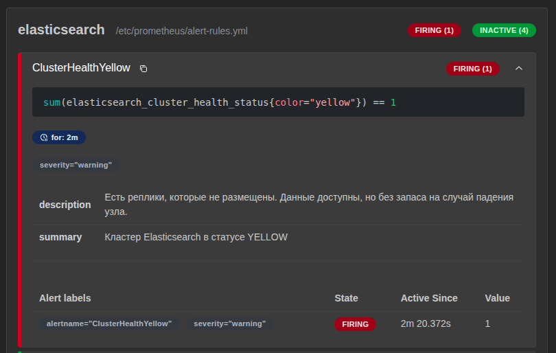

#### Вызовем `ClusterHealthDown`

Для этого остановим узел `docker pause es01`.

Через несколько секунд видим состояние на дашборде.


Через минуту видим алерт.

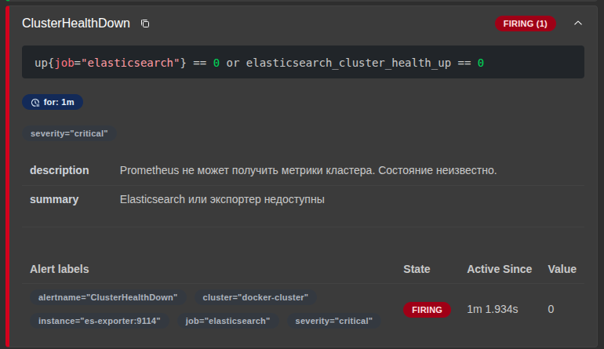

## Выводы

В ходе работы я впервые познакомился с ELK стеком. Стал четче понимать его цели, возможности и устройство работы. Попробовал по-разному развернуть Elasticsearch.

Достал реальные логи приложения, загрузил и проанализировал их: узнал, что примерно 43% записей вероятнее всего от поисковых ботов (но все же радует, что живых запросов больше). Познакомился с форматом запросов Elasticsearch, попробовал визуализацию в Kibana.

Написал политику ILM, создал для неё alias и index, прогнал через неё немного реальных логов, чтобы увидеть работу rollover вживую. Для мониторинга сделал внешний сервис, что оправдалось при падении кластера: алерт о падении пришел. Написал метрики и придумал алерты, вызвал пару из них.

[](https://www.linux.org/)
[](https://www.docker.com/)
[](https://www.elastic.co/elasticsearch/)
[](https://www.elastic.co/kibana)
[](https://prometheus.io/)
[](https://grafana.com/)
